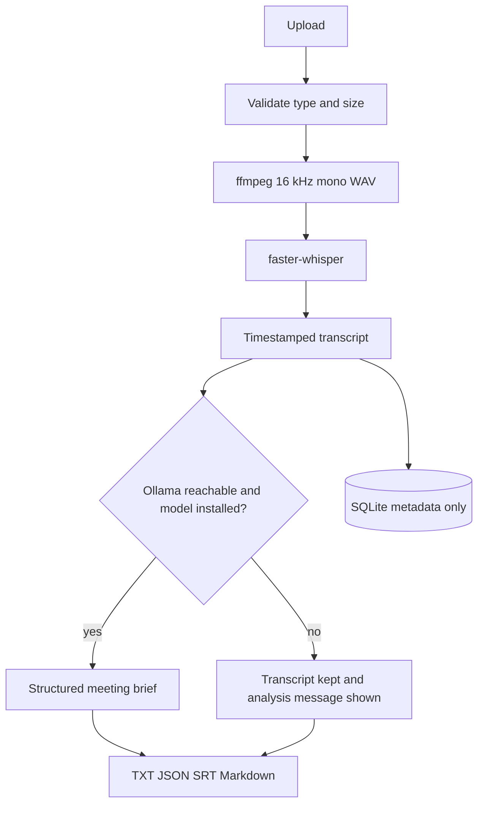
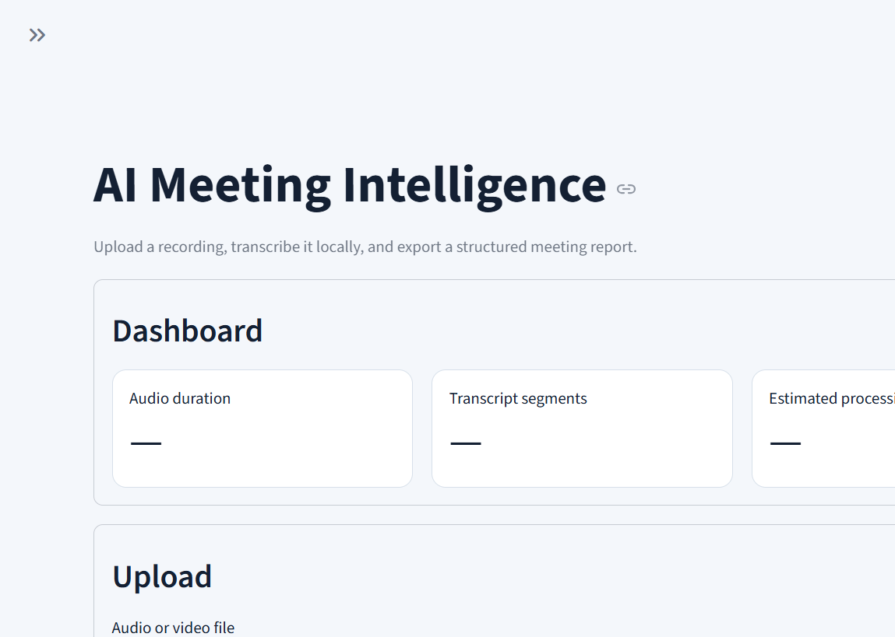

# AI Meeting Intelligence

Local meeting transcription and structured meeting briefs. Upload audio or video, get a timestamped transcript, and optionally ask a local model for a summary, decisions, action items, risks, and follow-up questions.

No paid API is required.

## Problem

Meeting recordings are easy to collect and hard to reuse. A raw audio file does not show what was decided, who owns the next step, or which risks were raised. Sending that audio to a paid transcription API also moves private conversations off the machine.

## Solution

This app transcribes the recording on your own computer with faster-whisper, then asks Ollama for a structured brief when a local model is available. Transcripts are saved as text, JSON, SRT, and a Markdown report. SQLite stores only meeting metadata. If Ollama is not running, transcription still finishes and the page shows: AI analysis unavailable — start Ollama to enable meeting intelligence.

## Why this project matters

A small team often leaves decisions inside a recording. This app turns that recording into a transcript and a brief the team can file: what was decided, who owns the next task, and which risks were named. The audio stays on the machine. Transcription still finishes when the local model is down, so a missing LLM does not block the meeting record.

## Engineering Highlights

- Local speech-to-text with faster-whisper. Weights download on first use and stay cached.
- Timestamped transcription, plus plain text, SRT, and JSON.
- Structured meeting intelligence: title, summary, key points, decisions, action items, risks, and follow-up questions.
- Local LLM integration through Ollama, with a health check before any completion request.
- Graceful LLM fallback. If Ollama is down, the transcript remains and the page explains that analysis is unavailable.
- Export pipeline for TXT, JSON, SRT, and a Markdown meeting report.
- Docker image with Python 3.12, ffmpeg, and a non-root user. The image does not contain Whisper or Ollama weights.
- Automated tests for validation, formatting, exports, SQLite metadata, analysis parsing, and the unavailable-LLM path.

## Technical Architecture



```text
app/
  main.py                 Streamlit entry point
  config.py               Environment settings and data paths
  ui/                     Dashboard, upload, transcript, and exports
  services/
    transcription.py      faster-whisper, cached after the first load
    summarization.py      Prompts and response parsing
    meeting_analysis.py   Summary, actions, decisions, risks, follow-ups
    export.py             TXT, JSON, SRT, and Markdown
    llm.py                Optional Ollama client
    storage.py            SQLite metadata only
  models/                 Pydantic schemas
  utils/                  ffmpeg, uploads, logging, timestamps
data/uploads/             Original recordings
data/outputs/             Transcripts and reports
data/meetings.db          Meeting id, filename, time, duration, model, paths, status
```

ffmpeg converts the upload to 16 kHz mono WAV. faster-whisper returns timestamped segments. Ollama is called only after that transcript exists. Speaker labels are optional pause estimates, not voice identification. See [docs/architecture.md](docs/architecture.md).

## Features

- Dashboard with duration, segment count, estimated processing time, and action-item count
- Upload validation, size limits, and sanitized filenames
- Timestamped transcript, plain text, SRT, and JSON
- Meeting summary, key points, decisions, action items, risks, and follow-up questions
- Downloads for TXT, JSON, SRT, and a Markdown meeting report
- SQLite history for metadata, with transcript files kept on disk
- Clear message when the local LLM is unavailable
- Structured JSON logs that omit secrets, credentials, and full transcripts

## AI Pipeline

1. The upload is checked for type and size, then stored under a generated meeting id.
2. ffmpeg prepares a 16 kHz mono WAV in a temporary directory.
3. faster-whisper transcribes it. The model stays cached for later requests.
4. Segments become plain text, a timestamped transcript, SRT, and JSON.
5. The app checks whether Ollama is reachable and whether `OLLAMA_MODEL` is installed.
6. When both are ready, the transcript is turned into a JSON meeting brief.
7. TXT, JSON, SRT, and Markdown are written under `data/outputs/`. The database stores the meeting id, filename, timestamp, duration, model, transcript path, and analysis status.

`tiny`, `base`, and `small` are the models offered in the interface. `base` is the default. Set `WHISPER_MODEL=tiny` on a small CPU or a free Hugging Face Space. Weights download at runtime and are not baked into the Docker image.

## Tech Stack

- Python 3.12
- Streamlit
- faster-whisper
- ffmpeg
- Pydantic
- SQLite
- Ollama for optional local analysis
- Docker

## Local Setup

Python 3.12 and ffmpeg are required. The first transcription downloads the selected Whisper weights.

### Windows

```powershell
py -3.12 -m venv .venv
.venv\Scripts\activate
python -m pip install --upgrade pip
pip install -r requirements-dev.txt
copy .env.example .env
streamlit run app/main.py
```

Open http://127.0.0.1:8501.

```powershell
WHISPER_MODEL=base
OLLAMA_BASE_URL=http://localhost:11434
OLLAMA_MODEL=qwen2.5:3b
MAX_UPLOAD_MB=200
DEVICE=cpu
COMPUTE_TYPE=int8
```

`MAX_UPLOAD_MB` is enforced by the application. Streamlit has its own limit in `.streamlit/config.toml` (`server.maxUploadSize`). Keep those two values equal.

## Ollama Setup

Ollama is optional. Install it from [ollama.com](https://ollama.com/), then confirm the CLI, download a model, and start the server:

```powershell
ollama --version
ollama pull qwen2.5:3b
ollama serve
```

`OLLAMA_MODEL` chooses which local model is used. The default is `qwen2.5:3b`. The app does not assume that model is already installed. It asks Ollama which models are present before requesting an analysis. If the server is not running, transcription still finishes and the page shows: AI analysis unavailable — start Ollama to enable meeting intelligence.

`ollama serve` is only needed when the Ollama app is not already running. Use **Check local LLM** in the sidebar, or:

```powershell
python scripts/check_env.py
```

From Docker, the app calls Ollama on the host at `http://host.docker.internal:11434`.

## Docker

The image uses Python 3.12, installs ffmpeg, runs as user id 1000, and leaves Whisper weights out of the image. They download into the cache volume on the first transcription.

```powershell
docker compose build
docker compose up
```

Open http://localhost:8501. `data/` is mounted into the container. Stop the stack with `docker compose down`.

Copy `.env.example` to `.env` before `docker compose up` when you want to override the defaults. Compose reads that file automatically. Set `WHISPER_MODEL=tiny` when the host has limited CPU or RAM.

## Testing

```powershell
pip install -r requirements-dev.txt
pytest -q
python -m compileall app
```

The tests cover file validation, transcript formatting, JSON schema, SRT generation, analysis parsing, the Ollama-unavailable path, export files, SQLite metadata, and log redaction. They do not download Whisper weights.

## Deployment

This repository is set up for a Docker-based [Hugging Face Space](https://huggingface.co/docs/hub/spaces-sdks-docker). The YAML block at the top of this file selects the Docker SDK and port 8501.

1. Create a new Space with the Docker SDK.
2. Push this repository, including `Dockerfile`, `requirements.txt`, `app/`, and `.streamlit/`.
3. In the Space settings, set `WHISPER_MODEL` to `tiny` or `base` based on the CPU and RAM of the hardware. `tiny` is the safer default on a free CPU Space. `base` is a better default on a machine with a few gigabytes free.
4. Keep `DEVICE=cpu` and `COMPUTE_TYPE=int8`.
5. Leave Ollama unset on the Space unless you run an Ollama server the Space can reach. Transcription still works, and analysis shows the unavailable message.
6. The first visit that transcribes a file downloads the Whisper weights into the container cache. The image itself does not contain those weights.

For a private server, publish port 8501 only on a trusted network. The app has no user accounts. Persist `data/` and the Whisper cache so transcripts and model files survive restarts.

## Screenshots



The checked-in capture is the dashboard before a file is transcribed. The filled transcript, summary, and action-item views are part of the live demo in [docs/demo-script.md](docs/demo-script.md).

A 60–90 second walkthrough for a recruiter is in [docs/demo-script.md](docs/demo-script.md). Talking points for the design choices are in [docs/interview-notes.md](docs/interview-notes.md).

## Limitations

- CPU transcription of a long meeting can take longer than the meeting.
- Speaker names are pause-based estimates when that option is enabled. The project does not identify voices.
- Analysis quality depends on the local Ollama model. A 3B model can miss details.
- Analysis reads at most four chunks of about 10,000 characters. Longer meetings keep a note that only the earlier portion was analyzed.
- The first Whisper run needs a network connection to download weights.
- There is no login. Do not expose the server to the public internet as-is.
- Hugging Face Spaces does not include Ollama, so meeting analysis stays unavailable there unless you point `OLLAMA_BASE_URL` at a reachable server.
- Whisper model weights and Ollama models have their own licenses. This repository does not redistribute them.

## Future Improvements

- Real speaker diarization instead of pause-based labels
- Search across saved meetings
- Editable action items before export
- Optional GPU transcription when CUDA is present in the container
- A smaller default model profile for free hosted CPU deployments
