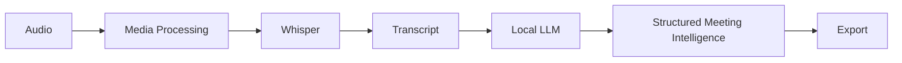

# Architecture

Meeting Intelligence is a local Streamlit application. Transcription does not
call the LLM. Analysis calls Ollama only after a transcript exists, and a
failed LLM check returns a message instead of an exception.

## Modules

| Module | Responsibility |
| --- | --- |
| `app/main.py` | Streamlit entry point |
| `app/config.py` | Environment settings and data paths |
| `app/ui/` | Sidebar, page flow, and result views |
| `app/services/transcription.py` | Whisper transcription |
| `app/services/summarization.py` | Prompt construction and JSON parsing |
| `app/services/meeting_analysis.py` | Summary, decisions, actions, and follow-ups |
| `app/services/export.py` | Text, Markdown, and JSON reports |
| `app/services/llm.py` | Optional Ollama client |
| `app/services/storage.py` | Meeting metadata in SQLite |
| `app/utils/media.py` | ffmpeg and ffprobe |
| `app/utils/speakers.py` | Pause-based turn labels |

Uploads are stored in `data/uploads`. Reports are stored in `data/outputs`.
The SQLite file is `data/meetings.db`. Paths are resolved from the repository
root, not from a machine-specific absolute path in source code.
